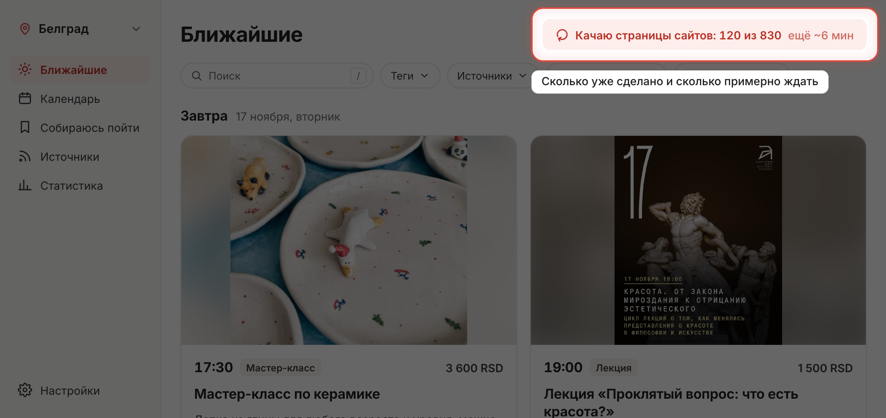
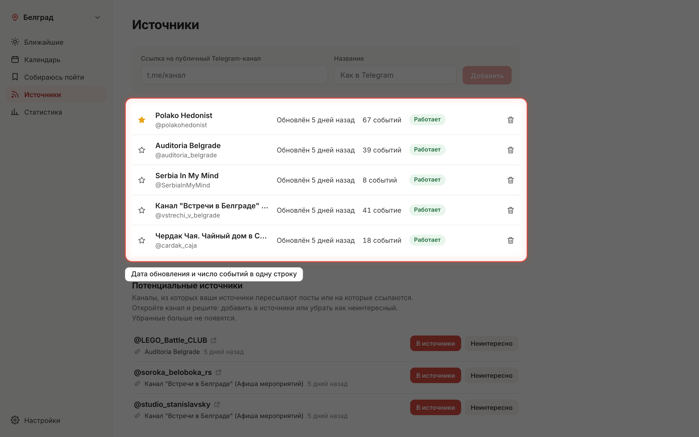
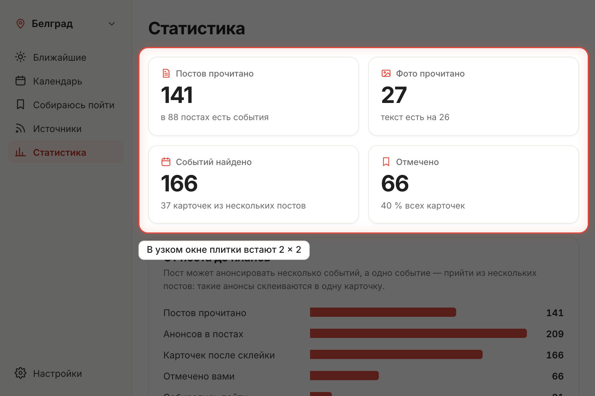
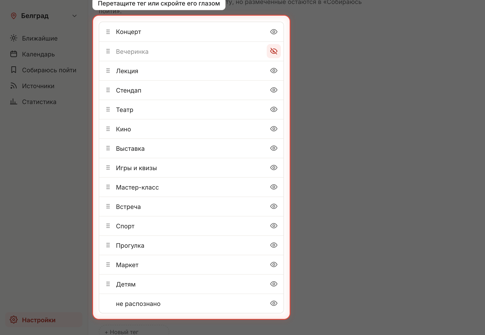
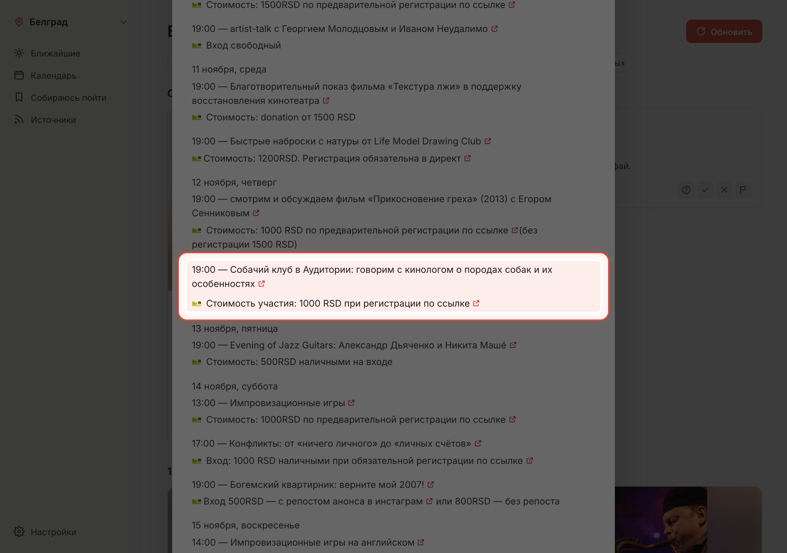
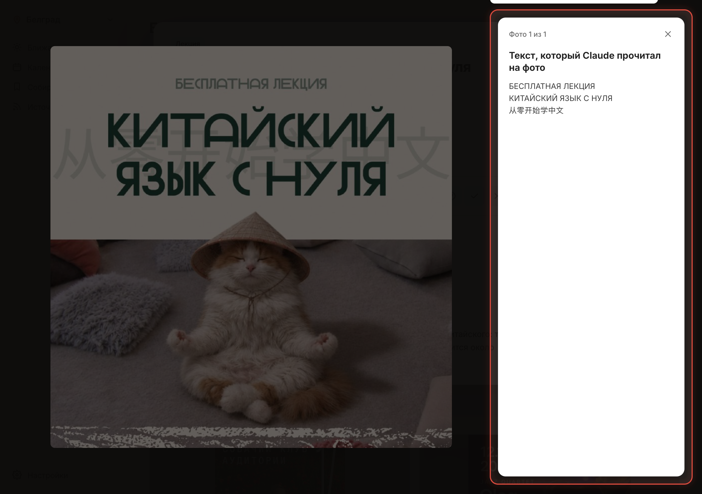

# Что нового

Что менялось в каждом релизе «What To Do», сверху самое новое.

## 1.11.0 — 2026-11-16

Во время обновления видно, сколько уже сделано и сколько примерно ждать.

### Прогресс обновления
Кнопка «Обновить» считает каждый этап: сколько источников уже собрано, сколько страниц сайтов скачано, сколько фото и постов прочитано. Рядом показывается, сколько примерно осталось, по тому, как быстро идёт текущий этап.

## 1.10.2 — 2026-11-16

Даты и места событий с сайтов теперь точно как на сайте.

### Улучшения
- Дату, время, место и цену события с сайта приложение берёт прямо со страницы, а не из пересказа Claude, поэтому они больше не могут перепутаться. Claude пишет только название, описание и теги.

## 1.10.1 — 2026-11-15

Сайты-афиши тратят меньше Claude и читаются надёжнее.

### Улучшения
- События с сайта из других городов и онлайн-события больше не уходят в Claude. Какие названия мест относятся к вашему городу, приложение спрашивает у Claude один раз и запоминает.
- В предпросмотре сайта видно, сколько на нём событий и какие из них попадут в приложение.

- Сайт добавляется сразу после предпросмотра, без второй проверки.
- Если сайт просит не спешить, приложение ждёт и докачивает все страницы, а не пропускает их.
- Ближайшие события сайта перепроверяются раз в сутки, поэтому «Обновить» не тянется лишние минуты.
- Описания с сайтов показываются обычным текстом, без служебной разметки.

### Исправлено
- Ссылки на сайт с www и без него считаются одним сайтом.
- Событие, которое сайт опубликовал позже своей страницы, всё равно попадёт в приложение.

## 1.10.0 — 2026-11-15

Теперь события можно брать не только из Telegram-каналов, но и с сайтов-афиш.

### Сайты с афишей
Вставьте в «Источниках» ссылку на любое событие с сайта-афиши. Приложение само найдёт на сайте список всех событий и покажет, сколько страниц нашлось и какие события ближайшие. После «Добавить сайт» он появится в списке рядом с каналами, а «Обновить» будет забирать с него события на 30 дней вперёд. Они склеиваются с теми же событиями из каналов. Подходят сайты, которые размечают события для поисковиков, например Polako Hedonist. Если сайт так не умеет, приложение скажет об этом сразу.

### Улучшения
- У событий с сайта кнопка называется «Открыть на сайте» и ведёт на страницу события.
- Канал или сайт, который уже есть в источниках, не добавится второй раз: приложение предупредит об этом.

## 1.9.1 — 2026-11-15

Исправлена полоса под заголовком окна.

### Исправлено
- В приложении для macOS прокрученные карточки и события больше не просвечивают в полосе заголовка окна, где кнопки закрытия. В календаре над закреплённой строкой дней теперь чисто.

## 1.9.0 — 2026-11-15

Интерфейс отвечает на каждое действие: кнопки откликаются на нажатие, окна и меню плавно появляются и исчезают, а календарём удобнее пользоваться.

### Календарь
- Дни недели остаются наверху, когда прокручиваешь длинную неделю.
- Если поиск ничего не нашёл в этой неделе, календарь так и говорит и подсказывает, сколько таких событий в «Ближайших».

- Длинные латинские имена переносятся по слогам («Shcher-ba-kova»), а не после любой буквы.
- Сетка недели больше не выходит за края экрана.

### Улучшения
- Все кнопки, чипы, оценки и пункты меню показывают нажатие. Включённые при нажатии сохраняют свой цвет.
- На наведение отвечают все элементы, в том числе включённые фильтры, отмеченные события в календаре, «Впереди / Прошедшие» и «+ Добавить город». Скорость отклика у всех одинаковая.
- Окна закрываются плавно, как и открываются. Меню появляются и исчезают с короткой анимацией.
- Переключатель «Кратко / Оригинал» в окне события выглядит так же, как «Впереди / Прошедшие».
- В «Собираюсь пойти» переключатель «Впереди / Прошедшие» переехал в шапку, и фильтры помещаются в одну строку.

- Карточки в одном ряду одной высоты, оценки и статусы стоят на одной линии.

- Поля ввода той же высоты, что кнопки рядом. В настройках выбор модели выровнен по полям над ним.

## 1.8.1 — 2026-11-15

Исправлены визуальные огрехи на экранах «Источники», «Календарь», «Статистика» и в меню фильтров.

### Исправлено
- «Источники»: дата обновления и число событий больше не разрываются на две строки, колонки стоят ровно.

- «Календарь»: в узком окне длинные латинские имена переносятся с дефисом, а не рвутся посреди слова.
- «Статистика»: в узком окне четыре плитки сверху встают 2 × 2, без одинокой плитки во втором ряду.

- «Статистика»: короткие полоски в «Тегах» и «Источниках» больше не выглядят обрубленными полукругами.
- Меню фильтров стало шире, и чекбокс стоит у первой строки длинного названия канала.

## 1.8.0 — 2026-11-14

Теги теперь можно скрывать из ленты и расставлять в своём порядке.

### Чёрный список и порядок тегов
В настройках теги стали списком. Нажмите на глаз рядом с тегом — он попадёт в чёрный список, и события с ним пропадут из ленты. События, которые вы уже отметили, остаются в «Собираюсь пойти», даже если у них скрытый тег. Перетащите тег за ручку слева, чтобы поменять порядок: в нём теги показываются на карточках и в окне события, а у карточки с несколькими тегами виден самый важный для вас.

## 1.7.1 — 2026-11-12

Исправление: у событий снова виден оригинал поста.

### Исправлено
- Во вкладке «Оригинал» было пусто, и в окне события пропадала кнопка «Открыть пост». Так случалось, когда другая программа на компьютере занимала тот же порт, что и приложение: запросы постов уходили к ней. Теперь приложение обращается только к своему серверу и при запуске проверяет, что отвечает именно оно.
- Если посты всё же не загрузились, вкладка «Оригинал» так и пишет и даёт кнопку «Попробовать ещё раз», а не притворяется пустой.

## 1.7.0 — 2026-11-11

Новый экран «Статистика»: всё, что приложение прочитало и нашло, в числах и графиках.

### Статистика
В меню появился раздел «Статистика». Сверху — главные числа: сколько постов и фото прочитал Claude, сколько событий нашлось и сколько из них вы отметили. Ниже — путь от поста до ваших планов: сколько анонсов было в постах и сколько карточек осталось после склейки дублей. Ещё там статусы и оценки интереса ваших карточек, посты по неделям, самые частые теги и какой канал сколько событий даёт. Наведите на столбик — увидите точные числа.

## 1.6.2 — 2026-11-10

Поиск находит любую карточку, как бы она ни была отмечена.

### Исправлено
- Карточку, отмеченную «Не пойду», раньше нельзя было найти нигде, даже поиском, и снять отметку тоже было негде. Теперь поиск на любом экране находит карточки с любой отметкой. В календаре карточки с «Не пойду» зачёркнуты, а в ленте видна их отметка, и её можно снять. Без поиска всё показывается как раньше.

## 1.6.1 — 2026-11-10

Фото на карточках событий из постов с одной общей обложкой и более надёжная кнопка обновления.

### Исправлено
- Если в посте одно фото и Claude не отдал его ни одному событию, например обложка «В какие музеи сходить бесплатно 11 ноября», теперь оно есть на карточке каждого события из этого поста. Карточки, которые у вас уже есть, получат его при следующем обновлении, без вызовов Claude.

- Кнопка «Обновить до…» иногда показывала, что обновление не удалось, хотя оно шло нормально. Это исправление заработает со следующего обновления после этого.

## 1.6.0 — 2026-11-10

Потенциальный источник добавляется одной кнопкой.

### Добавить или убрать в один клик
У каждого потенциального источника теперь две кнопки вместо галочки. «В источники» сразу добавляет канал в ваши источники, и он уходит из списка. «Неинтересно» убирает канал в свёрнутый блок «Неинтересные», откуда его можно вернуть. Если канал добавить не получилось, например он закрыт или у него выключен веб-просмотр, он остаётся в списке, а под ним написано почему.

## 1.5.1 — 2026-11-10

Фото у каждой лекции цикла и правка промптов без лишних вызовов Claude.

### Исправлено
- Если в посте анонсирован цикл лекций с одной общей афишей, эта афиша теперь есть на карточке каждой лекции, а не только первой. Карточки, которые у вас уже есть, получат её при следующем обновлении, без вызовов Claude.

### Улучшения
- Правка промптов в настройках больше не перечитывает уже разобранные посты: новый текст действует для новых постов, и обновление не тратит лишние вызовы Claude.

## 1.5.0 — 2026-11-10

Источники можно отмечать звездой, чтобы не теряться среди многих каналов.

### Избранные источники
У каждого канала на странице «Источники» есть звезда. Новый канал добавляется без неё, а нажатие на звезду переносит его в избранные: они стоят в начале списка. Повторное нажатие снимает отметку. Звезда нужна только для вашей разметки и не влияет ни на обновление, ни на ленту.

## 1.4.2 — 2026-11-10

Кнопки оценки на карточке снова в одну строку.

### Исправлено
- В узкой колонке ленты оценка 1–5, заметка и кнопки статуса помещаются в одну строку, а не переносятся вниз.

## 1.4.1 — 2026-11-10

Внутренняя правка ссылок на запись.

### Исправлено
- Ссылка на запись или билеты в карточке события сохраняется без предупреждений в журнале приложения при обновлении.

## 1.4.0 — 2026-11-10

Приложение подсказывает новые каналы: те, из которых ваши источники пересылают посты или на которые ссылаются.

### Потенциальные источники
При обновлении Claude отмечает каналы, на которые ссылается пост, и каналы, из которых он переслан. Они собираются на странице «Источники» в разделе «Потенциальные источники». У каждого канала видно, из каких постов он пришёл, а сам канал и эти посты открываются по ссылке. Понравился канал — добавьте его вручную, как обычно. Отметьте «Разобрано», и канал больше не появится. Каналы, которые уже есть в источниках, и боты в список не попадают.

### Улучшения
- Чтобы собрать каналы из уже прочитанных постов, при первом обновлении после установки последние посты каждого канала перечитываются заново.

## 1.3.1 — 2026-11-10

Лента и окно события откликаются сразу и ничего не дёргается.

### Исправлено
- Тень карточки при наведении появляется и уходит мгновенно, а фото на этой и соседних карточках больше не дёргаются.
- Окно события открывается сразу целиком: без промежуточного «Загружаю…», без прыжка размера и тени, кнопки и фото на месте с первого кадра.
- Пока открыто окно события, раздел под ним остаётся подсвеченным в меню.

## 1.3.0 — 2026-11-10

На карточке можно оставить заметку разработчику: что доработать в этом событии или в приложении.

### Заметки разработчику
Рядом со шкалой интереса 1–5 появилась кнопка с облачком. Она открывает окно, куда пишется любой текст: «сюда просится новый тег», «криво разобралось время». Заметки копятся в базе для будущих доработок и в приложении больше нигде не показываются.

## 1.2.0 — 2026-11-10

Окно события показывает оригинальные посты: можно сверить, что написал Claude, с тем, что написали в канале.

### Новое окно события
Сверху суть: название, время, место, цена, кнопка записи и кнопка «В календарь». Ниже две вкладки. «Кратко» — афиша и описание. «Оригинал» — сам пост: все его фото и текст как есть, строки про это событие подсвечены, и пост сразу прокручивается к ним. Если о событии писали несколько каналов, посты выбираются плашками сверху.

### Новое
- Кнопка «Записаться» или «Купить билет», когда в посте есть ссылка на запись или билеты.
- Любое фото открывается крупно, а рядом — текст, который Claude прочитал на нём.

### Улучшения
- Добавить событие в календарь теперь можно отдельной кнопкой.

## 1.1.0 — 2026-11-10

Фото постов читаются отдельно, а модель Claude для каждого шага выбирается в настройках.

### Новое
- «Настройки → Модели Claude»: для расшифровки фото, разбора постов и склейки повторов можно выбрать Haiku, Sonnet или Opus.
- Свой промпт для расшифровки фото в «Промптах для Claude».

### Улучшения
- Текст с афиш и картинок переписывается отдельным шагом и сохраняется, поэтому полное описание с постера больше не теряется. Пока идёт обновление, кнопка показывает «Читаю фото: N из M».

### Исправлено
- Приложение называется What To Do.

## 1.0.0 — 2026-11-10

Первый релиз: у «What To Do» появились версии, своё приложение для macOS и обновление одной кнопкой.

### Приложение для macOS
«What To Do» открывается в своём окне, без браузера. Приложение само запускает сервер при старте и останавливает его при выходе. В меню есть «Настройки…» (⌘,), «Проверить обновления…», масштаб и перезагрузка страницы.

### Обновление одной кнопкой
Раз в день приложение проверяет, не вышла ли новая версия. Если вышла, в боковой колонке появляется «Новая версия». Она открывает список изменений с кнопкой «Обновить». Пока идёт обновление, видно его этапы. После обновления один раз показывается «Что нового». Всю историю изменений можно открыть в «Настройки → Приложение».
