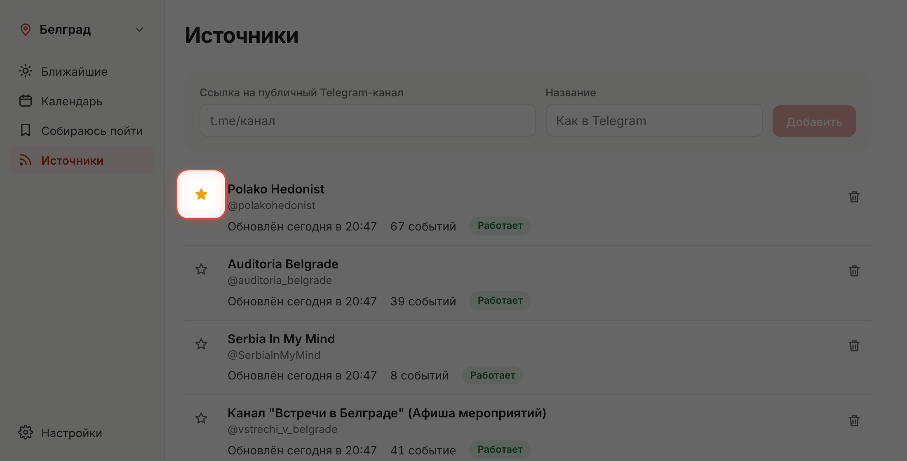
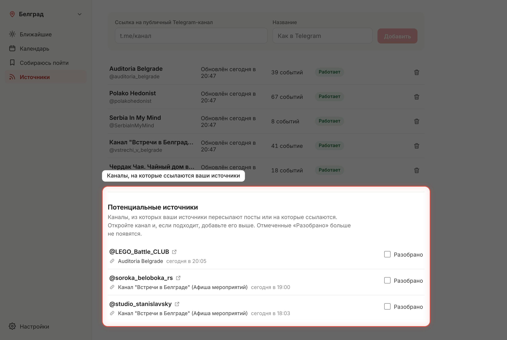
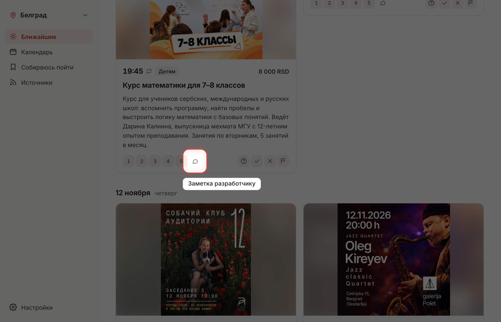
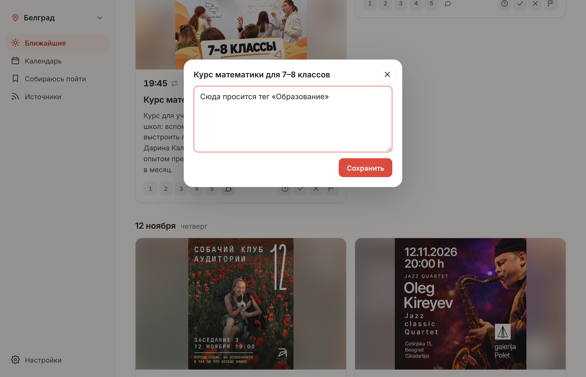
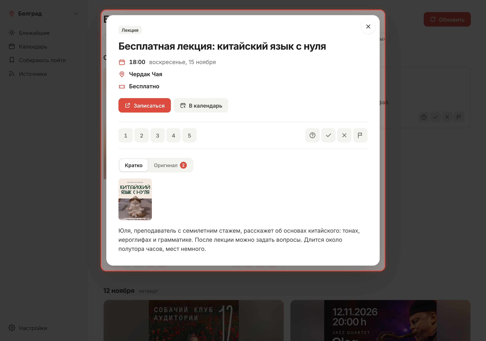
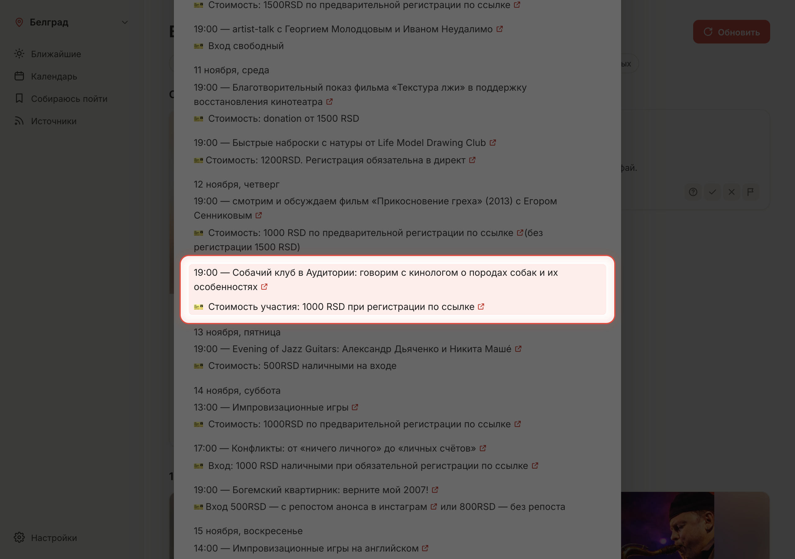
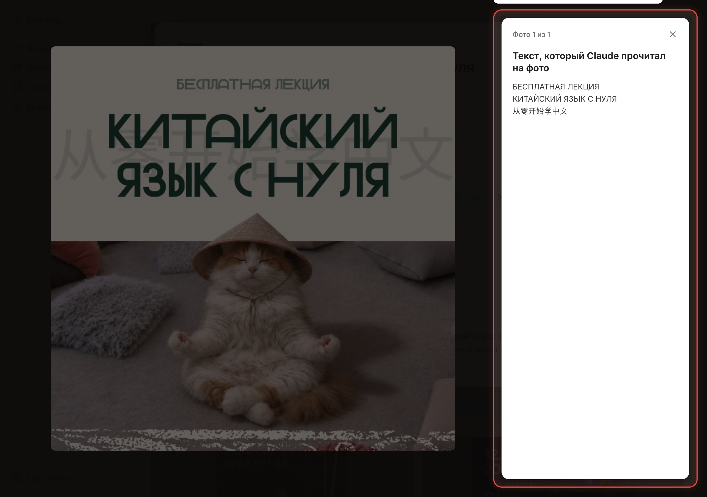

# Что нового

Что менялось в каждом релизе «What To Do», сверху самое новое.

## 1.5.0 — 2026-11-10

Источники можно отмечать звездой, чтобы не теряться среди многих каналов.

### Избранные источники
У каждого канала на странице «Источники» есть звезда. Новый канал добавляется без неё, а нажатие на звезду переносит его в избранные: они стоят в начале списка. Повторное нажатие снимает отметку. Звезда нужна только для вашей разметки и не влияет ни на обновление, ни на ленту.

## 1.4.2 — 2026-11-10

Кнопки оценки на карточке снова в одну строку.

### Исправлено
- В узкой колонке ленты оценка 1–5, заметка и кнопки статуса помещаются в одну строку, а не переносятся вниз.

## 1.4.1 — 2026-11-10

Внутренняя правка ссылок на запись.

### Исправлено
- Ссылка на запись или билеты в карточке события сохраняется без предупреждений в журнале приложения при обновлении.

## 1.4.0 — 2026-11-10

Приложение подсказывает новые каналы: те, из которых ваши источники пересылают посты или на которые ссылаются.

### Потенциальные источники
При обновлении Claude отмечает каналы, на которые ссылается пост, и каналы, из которых он переслан. Они собираются на странице «Источники» в разделе «Потенциальные источники». У каждого канала видно, из каких постов он пришёл, а сам канал и эти посты открываются по ссылке. Понравился канал — добавьте его вручную, как обычно. Отметьте «Разобрано», и канал больше не появится. Каналы, которые уже есть в источниках, и боты в список не попадают.

### Улучшения
- Чтобы собрать каналы из уже прочитанных постов, при первом обновлении после установки последние посты каждого канала перечитываются заново.

## 1.3.1 — 2026-11-10

Лента и окно события откликаются сразу и ничего не дёргается.

### Исправлено
- Тень карточки при наведении появляется и уходит мгновенно, а фото на этой и соседних карточках больше не дёргаются.
- Окно события открывается сразу целиком: без промежуточного «Загружаю…», без прыжка размера и тени, кнопки и фото на месте с первого кадра.
- Пока открыто окно события, раздел под ним остаётся подсвеченным в меню.

## 1.3.0 — 2026-11-10

На карточке можно оставить заметку разработчику: что доработать в этом событии или в приложении.

### Заметки разработчику
Рядом со шкалой интереса 1–5 появилась кнопка с облачком. Она открывает окно, куда пишется любой текст: «сюда просится новый тег», «криво разобралось время». Заметки копятся в базе для будущих доработок и в приложении больше нигде не показываются.

## 1.2.0 — 2026-11-10

Окно события показывает оригинальные посты: можно сверить, что написал Claude, с тем, что написали в канале.

### Новое окно события
Сверху суть: название, время, место, цена, кнопка записи и кнопка «В календарь». Ниже две вкладки. «Кратко» — афиша и описание. «Оригинал» — сам пост: все его фото и текст как есть, строки про это событие подсвечены, и пост сразу прокручивается к ним. Если о событии писали несколько каналов, посты выбираются плашками сверху.

### Новое
- Кнопка «Записаться» или «Купить билет», когда в посте есть ссылка на запись или билеты.
- Любое фото открывается крупно, а рядом — текст, который Claude прочитал на нём.

### Улучшения
- Добавить событие в календарь теперь можно отдельной кнопкой.

## 1.1.0 — 2026-11-10

Фото постов читаются отдельно, а модель Claude для каждого шага выбирается в настройках.

### Новое
- «Настройки → Модели Claude»: для расшифровки фото, разбора постов и склейки повторов можно выбрать Haiku, Sonnet или Opus.
- Свой промпт для расшифровки фото в «Промптах для Claude».

### Улучшения
- Текст с афиш и картинок переписывается отдельным шагом и сохраняется, поэтому полное описание с постера больше не теряется. Пока идёт обновление, кнопка показывает «Читаю фото: N из M».

### Исправлено
- Приложение называется What To Do.

## 1.0.0 — 2026-11-10

Первый релиз: у «What To Do» появились версии, своё приложение для macOS и обновление одной кнопкой.

### Приложение для macOS
«What To Do» открывается в своём окне, без браузера. Приложение само запускает сервер при старте и останавливает его при выходе. В меню есть «Настройки…» (⌘,), «Проверить обновления…», масштаб и перезагрузка страницы.

### Обновление одной кнопкой
Раз в день приложение проверяет, не вышла ли новая версия. Если вышла, в боковой колонке появляется «Новая версия». Она открывает список изменений с кнопкой «Обновить». Пока идёт обновление, видно его этапы. После обновления один раз показывается «Что нового». Всю историю изменений можно открыть в «Настройки → Приложение».
