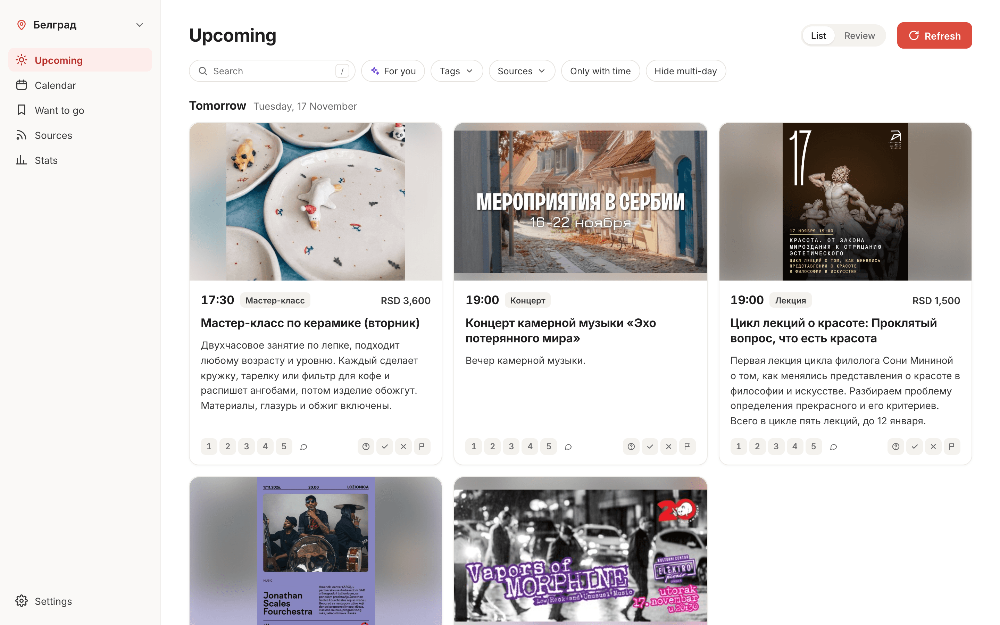
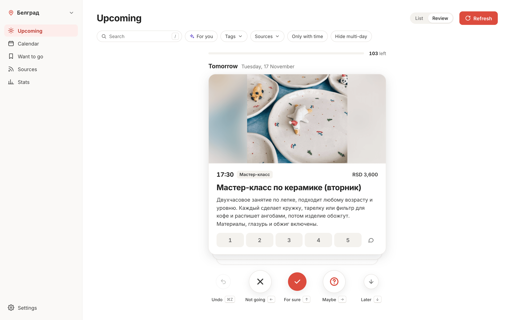
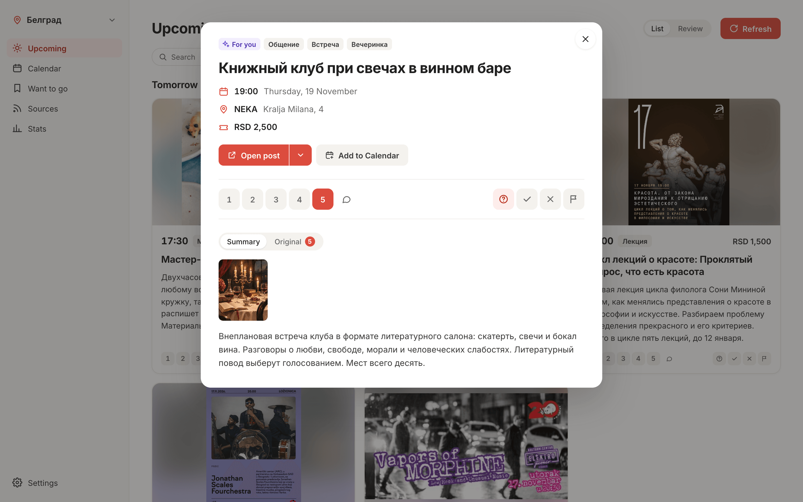
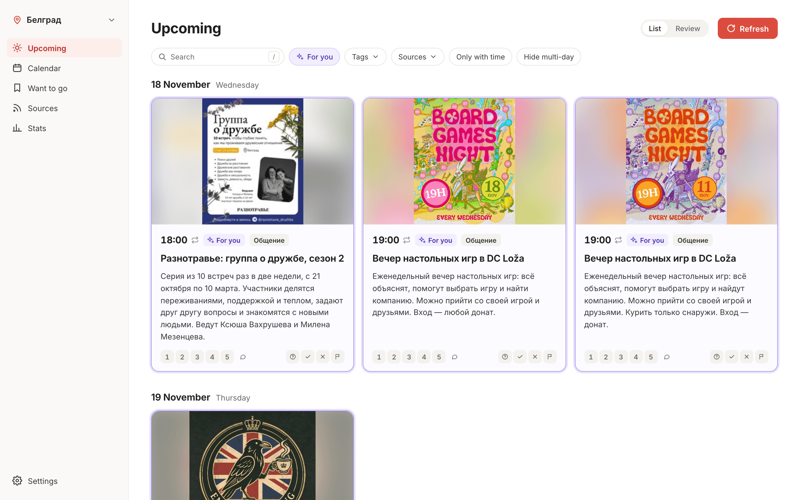
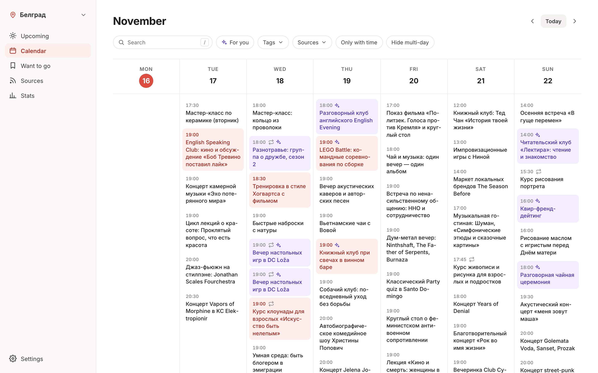
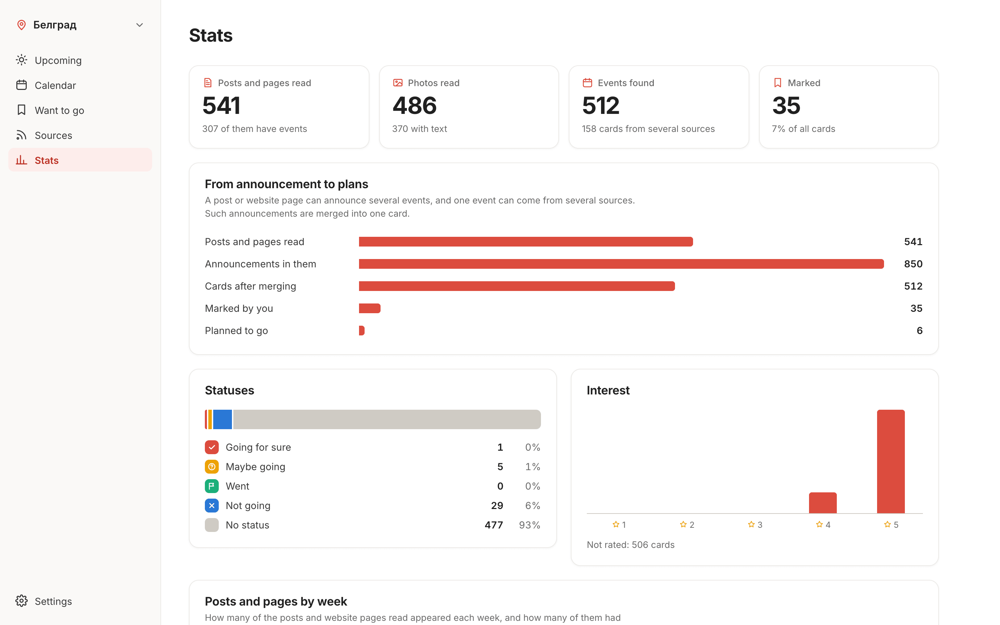
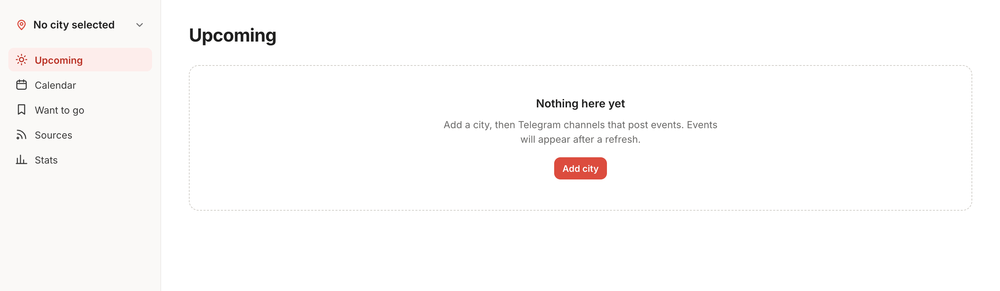
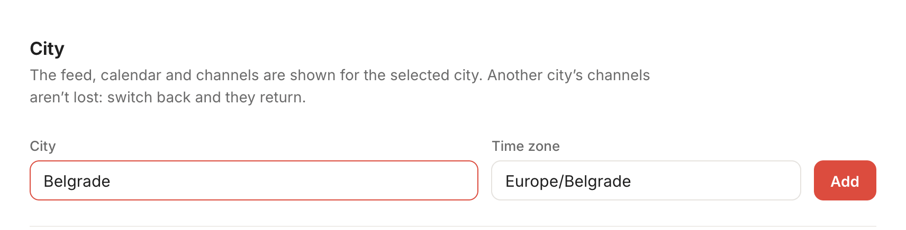
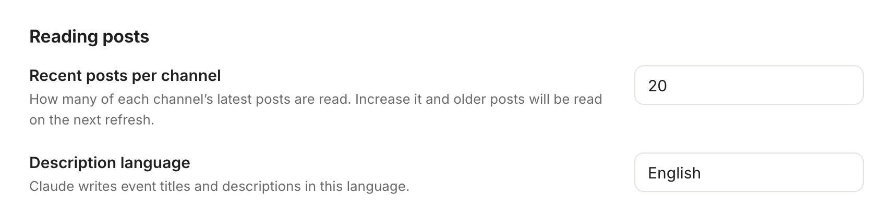
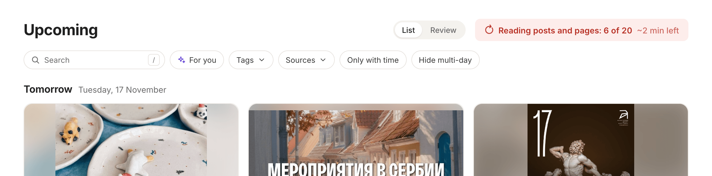

# What To Do

**Every event in your city from the Telegram channels and websites you follow, in one calm feed.**

Event announcements are scattered across dozens of channels: long digests, posters with the date only in the picture, the same concert posted five times. What To Do reads them for you. Claude turns each post into a clean event card, merges duplicates and lays everything out by day, so you can pick tonight's plan in a minute.

It runs on your own computer and uses your existing Claude subscription through Claude Code. No API key, no account, no server.



## Contents

- [Features](#features)
- [Requirements](#requirements)
- [Install and run](#install-and-run)
- [First steps](#first-steps)
- [FAQ](#faq)
- [For developers](#for-developers)
- [License](#license)

## Features

### A feed of what's ahead

**Upcoming** shows every event you haven't decided on yet, grouped by day. Each card has the poster, time, tag, price and a short description written by Claude. Search, filter by tag or source, or hide multi-day events. Rate your interest from 1 to 5 and mark a plan right on the card:

| Button | Meaning |
| --- | --- |
| ✓ | Going for sure |
| ? | Maybe |
| ✕ | Not going |
| ⚑ | Went |

Once you pick a plan, the card leaves the feed, so the feed always shows only what is left to decide.

### Review mode: one card at a time

Switch **Upcoming** to **Review** and go through events like in a dating app. Drag the card, press the buttons under it or use the keys:

| Key | Answer |
| --- | --- |
| → | Maybe |
| ← | Not going |
| ↑ | For sure |
| ↓ | Later |
| 1–5 | Rate your interest |
| ⌘Z | Undo |



### The whole event in one window

Click a card to see the date, the place with a map link, the price, the sign-up or ticket link and the full description. **Add to Calendar** downloads an `.ics` file for Apple Calendar, Google Calendar or Outlook.



### Duplicates merged, originals one click away

When several channels announce the same event, you get one card, not five. The **Original** tab shows every post the card was built from, with the lines about this event highlighted, so you can always check Claude's summary against the source. Reschedules and cancellations update the existing card.


### "For you" highlights

In **Settings**, describe in your own words what you look for, for example "events made for meeting people". Claude marks the events that fit with **For you**: they get a violet frame, and the **For you** filter shows only them.



### Calendar and plans

**Calendar** shows the whole week at a glance, with your plans and **For you** events tinted. **Want to go** collects everything you marked as going or maybe.




### Sources you control

Add a public Telegram channel or an event page on a website. Each source shows when it was last read, how many events it brought and whether it works. Star your favorites, pause a source instead of deleting it, and check **Potential sources**: channels your sources forward from or link to, ready to add in one click.


### Stats

See how many posts and photos Claude read, how many announcements were merged into cards and which channels bring the most events.



### More

- **Several cities.** Each city has its own sources, feed and calendar. Switch between them in the top-left corner.
- **Your own tags.** Add, rename, reorder or hide tags in **Settings**. Events with a hidden tag leave the feed.
- **Your choice of Claude model** for each step: Haiku, Sonnet or Opus.
- **Editable prompts.** Every prompt Claude gets is in **Settings**.
- **One-button updates.** When a new version is out, **New version** appears in the sidebar with the list of changes and an **Update** button.
- **Optional macOS app** with its own window and a menu bar mode, see [docs/macos-app.md](docs/macos-app.md).

## Requirements

| What | Why | How to get it |
| --- | --- | --- |
| A Claude subscription | Claude reads the posts | [claude.ai](https://claude.ai) |
| Claude Code, installed and logged in | The app calls Claude through it, with no API key | [Claude Code setup](https://docs.claude.com/en/docs/claude-code/setup), then run `claude` once and log in |
| [uv](https://docs.astral.sh/uv/) | Runs the backend | It installs Python 3.13 by itself |
| [Node.js](https://nodejs.org) 20 or later, with npm | Builds the interface | |
| Git | Install and update | |
| `make` (macOS only) | Starts and stops the app | Comes with the Xcode Command Line Tools: `xcode-select --install` |

Check Claude Code before you start: `claude --version` prints a version, and `claude` opens without asking you to log in.

## Install and run

> **Status.** macOS is the main platform and is used every day. Linux and Windows run the same app by hand, but they are not tested yet, and the in-app **Update** button needs macOS.

### macOS

| Step | What to do |
| --- | --- |
| Install | `git clone https://github.com/kudrmax/what-to-do.git && cd what-to-do` |
| Run | `make up`, then open the address it prints: `http://127.0.0.1:18766` by default |
| Stop | `make down` |
| Update | Press **Update** in the app when **New version** appears, or run `make update` |
| Uninstall | `make down`, then move the `what-to-do` folder to the Trash |

`make up` installs the Python and npm packages, builds the interface and starts the app in the background. It reads its settings from `.env`, which it creates from `.env.example` on the first run:

| Variable | Default | Meaning |
| --- | --- | --- |
| `PORT` | `18766` | The app's address is `http://127.0.0.1:<PORT>` |
| `DATA_DIR` | `./data` | Your database and images. Empty means `~/Library/Application Support/where-to-go`: delete that folder too when you uninstall |
| `INSTANCE_ENV_NAME` | `dev` | Set it to `prod` to name the macOS app "What To Do" |

To use the macOS app instead of a browser tab, run `make app`, see [docs/macos-app.md](docs/macos-app.md). When you uninstall, also move the app from `~/Applications` to the Trash.

### Linux and Windows

`make up` relies on macOS tools, so start the app by hand:

```bash
git clone https://github.com/kudrmax/what-to-do.git
cd what-to-do
uv sync
cd frontend
npm ci
npm run build
cd ..
uv run where-to-go --ui frontend/dist
```

| Step | What to do |
| --- | --- |
| Run | The last command above, then open `http://127.0.0.1:18765` |
| Stop | Press Ctrl+C in that terminal |
| Update | `git pull`, then repeat `uv sync`, the `npm` steps and the run command |
| Uninstall | Delete the `what-to-do` folder and the data folder |

The data folder is `Library/Application Support/where-to-go` inside your home folder on every system, unless you pass `--data <folder>`. Pass `--port <number>` to use another port.

## First steps

### 1. Open the app

A fresh app has no city yet and shows **Nothing here yet**. Press **Add city**.



### 2. Add your city

Type the city name and check the time zone: it is filled in from your computer. Press **Add**. Claude gets the city name with every post, and the time zone decides what "today" is.



### 3. Choose the language of the cards

Claude writes event titles and descriptions in the language set in **Settings → Reading posts → Description language**. The default is Russian: type `English` or any other language, then click outside the field to save it.



While you are in **Settings**, you can also fill in **What I look for first** to get **For you** highlights, and rename the tags: they start in Russian too.

### 4. Add a source

Open **Sources**, paste a channel link such as `t.me/channelname` or `@channelname` and press **Add**.


Where to find channels:

- The channel must be **public**. To check, open `https://t.me/s/channelname` in a browser: you should see its posts without Telegram.
- In Telegram, search for your city's name together with words like "events", "concerts" or "meetups", in the local language too.
- Look up the venues you like: clubs, bars, museums and language schools often have a channel.
- After the first refresh, **Potential sources** under the list suggests channels your sources forward from or link to.

Websites work too: paste the link to any single event on an event website. The app finds the site's list of events, shows a preview, and adds the site with **Add website**. This works for sites that mark up their events for search engines; for other sites the app says so right away.

### 5. Press Refresh

Go back to **Upcoming** and press **Refresh**. The app downloads the recent posts of each source, Claude reads the posters and the texts, and then merges duplicates. The button shows each stage and roughly how long is left.



The first refresh reads up to 20 recent posts of each channel, so it can take several minutes. Later refreshes read only new posts. The app never refreshes on its own: press **Refresh** whenever you want fresh events.

### 6. Read the feed

Events appear in **Upcoming**, grouped by day. For each one, decide:

- Not interested? Press ✕, and the card leaves the feed.
- Might go? Press ? or ✓, and the card moves to **Want to go**.
- Not sure yet? Leave it: it stays in the feed until its day passes.

Click a card for the full details and the original posts. With a long feed, try **Review** mode.

## FAQ

**Refresh fails, or says Claude is not found.**
The app calls the `claude` command. Run `claude` in a terminal: if the command is missing, install Claude Code; if it asks you to log in, log in. The macOS app starts the server in a login shell, which reads `~/.zprofile` but not `~/.zshrc`: if it can't find `claude`, `uv` or `node`, add them to your `PATH` in `~/.zprofile`.

**`make up` says the port is busy.**
Another program uses the port. Stop it, or set another `PORT` in `.env` and run `make up` again. When you run the app by hand, pass `--port <number>`.

**Where is my data?**
In one folder: the SQLite database `where-to-go.sqlite3` and the downloaded images. With `make up`, it is `DATA_DIR` from `.env` (`./data` by default). Otherwise it is `~/Library/Application Support/where-to-go`, or the folder you pass with `--data`. To back it up, copy the folder while the app is stopped.

**What leaves my computer?**
Everything stays on your computer except:

| Where | What |
| --- | --- |
| Telegram (`t.me`) and the websites you add | The app downloads their public posts and event pages |
| Claude, through your Claude Code login | Post texts and photos, to turn them into events |
| GitHub | `git fetch` of this repository, to check for new versions |

The server listens only on `127.0.0.1`, so other devices on your network can't open it.

**How much of my Claude usage does it take?**
Every refresh spends Claude calls from your subscription's usage limits: for photos, for posts and for merging duplicates. Fewer channels, fewer recent posts per channel and the Haiku model in **Settings → Claude models** all mean less usage.

**A channel shows an error.**
The channel is private, or its web preview is turned off. Open `https://t.me/s/channelname` in a browser: if no posts show up, the app can't read them either.

## For developers

The architecture, the processing pipeline, tests and make commands are in [docs/development.md](docs/development.md). The macOS app is described in [docs/macos-app.md](docs/macos-app.md). What changed in each release is in [CHANGELOG.md](CHANGELOG.md).

## License

No license has been chosen yet.
