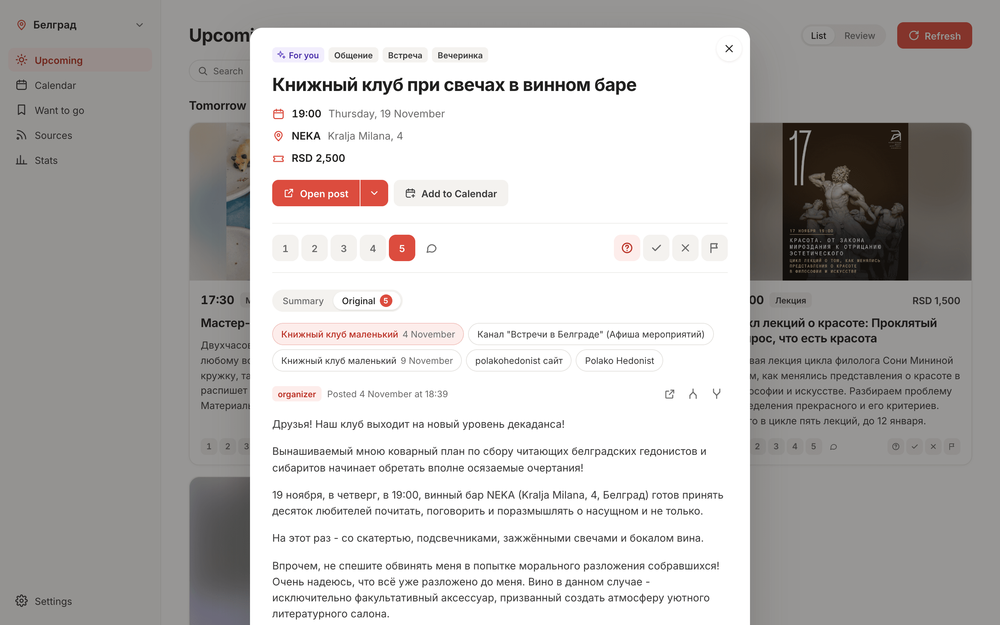
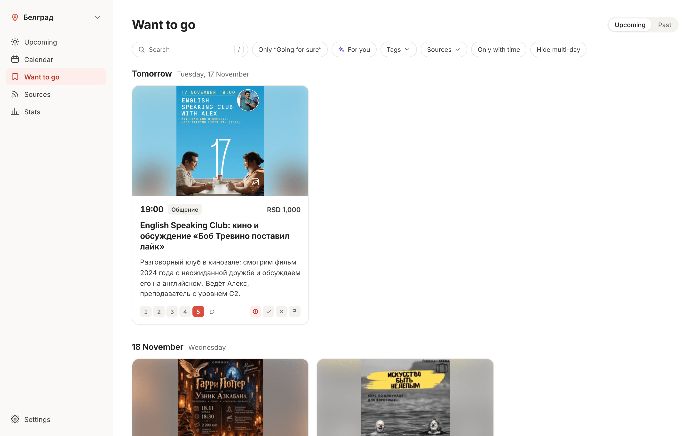
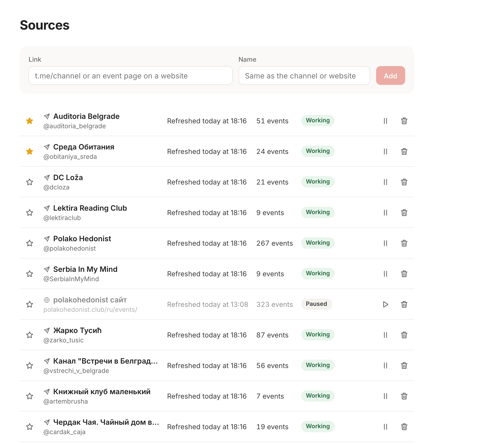
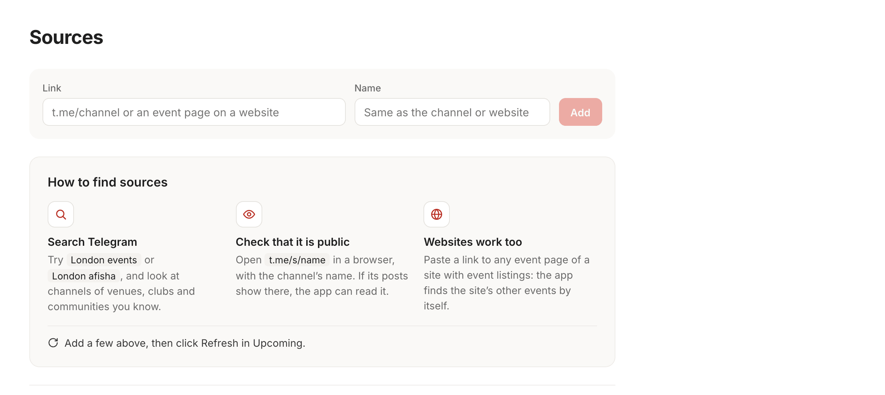
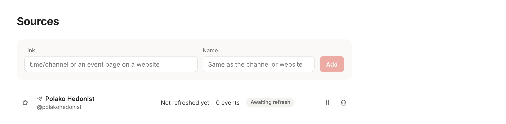
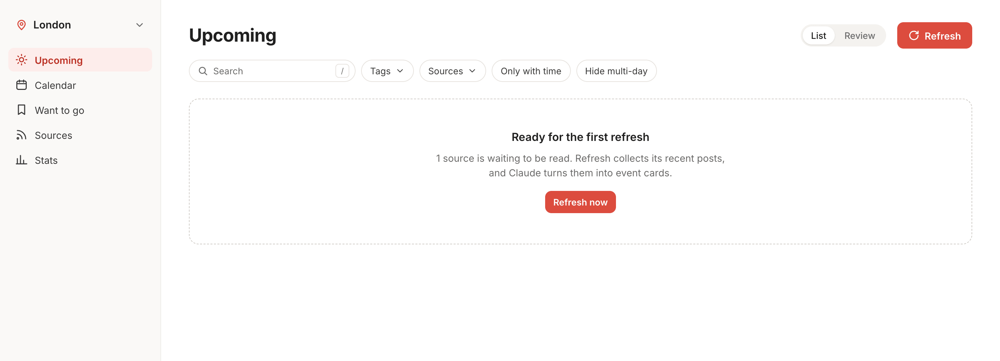

# What To Do

**Every event in your city from the Telegram channels and websites you follow, in one calm feed.**

Event announcements are scattered across dozens of channels: long digests, posters with the date only in the picture, the same concert posted five times. What To Do reads them for you. Claude turns each post into a clean event card, merges duplicates and lays everything out by day, so you can pick tonight's plan in a minute.

It runs on your own computer and uses your existing Claude subscription through Claude Code. No API key, no account, no server.


## Contents

- [Features](#features)
- [Requirements](#requirements)
- [Install and run](#install-and-run)
- [First steps](#first-steps)
- [FAQ](#faq)
- [For developers](#for-developers)
- [License](#license)

## Features

### A feed of what's ahead

**Upcoming** shows every event you haven't decided on yet, grouped by day. Each card has the poster, time, tag, price and a short description written by Claude. Search, filter by tag or source, or hide multi-day events. Rate your interest from 1 to 5 and mark a plan right on the card:

| Button | Meaning |
| --- | --- |
| ✓ | Going for sure |
| ? | Maybe |
| ✕ | Not going |
| ⚑ | Went |

Once you pick a plan, the card leaves the feed, so the feed always shows only what is left to decide.

### Review mode: one card at a time

Switch **Upcoming** to **Review** and go through events like in a dating app. Drag the card, press the buttons under it or use the keys:

| Key | Answer |
| --- | --- |
| → | Maybe |
| ← | Not going |
| ↑ | For sure |
| ↓ | Later |
| 1–5 | Rate your interest |
| ⌘Z | Undo |


### The whole event in one window

Click a card to see the date, the place with a map link, the price, the sign-up or ticket link and the full description. **Add to Calendar** downloads an `.ics` file for Apple Calendar, Google Calendar or Outlook.


### Duplicates merged, originals one click away

When several channels announce the same event, you get one card, not five. The **Original** tab shows every post the card was built from, with the lines about this event highlighted, so you can always check Claude's summary against the source. Reschedules and cancellations update the existing card.



### "For you" highlights

In **Settings**, describe in your own words what you look for, for example "events made for meeting people". Claude marks the events that fit with **For you**: they get a violet frame, and the **For you** filter shows only them.


### Calendar and plans

**Calendar** shows the whole week at a glance, with your plans and **For you** events tinted. **Want to go** collects everything you marked as going or maybe.




### Sources you control

Add a public Telegram channel or an event page on a website. Each source shows when it was last read, how many events it brought and whether it works. Star your favorites, pause a source instead of deleting it, and check **Potential sources**: channels your sources forward from or link to, ready to add in one click.



### Stats

See how many posts and photos Claude read, how many announcements were merged into cards and which channels bring the most events.


### More

- **Several cities.** Each city has its own sources, feed and calendar. Switch between them in the top-left corner.
- **Your own tags.** Add, rename, reorder or hide tags in **Settings**. Events with a hidden tag leave the feed.
- **Your choice of Claude model** for each step: Haiku, Sonnet or Opus.
- **Editable prompts.** Every prompt Claude gets is in **Settings**.
- **One-button updates.** When a new version is out, **New version** appears in the sidebar with the list of changes and an **Update** button.
- **Optional macOS app** with its own window and a menu bar mode, see [docs/macos-app.md](docs/macos-app.md).

## Requirements

| What | Why | How to get it |
| --- | --- | --- |
| A Claude subscription | Claude reads the posts | [claude.ai](https://claude.ai) |
| Claude Code, signed in | The app calls Claude through your Claude Code login, with no API key | Install [Claude Code](https://claude.com/claude-code), run `claude` in a terminal and type `/login` |
| [uv](https://docs.astral.sh/uv/getting-started/installation/) | Installs and runs the app | It also installs the right Python by itself |
| [Node.js](https://nodejs.org) 20 or later | Builds the interface on the first start and after updates that change it | |
| [Git](https://git-scm.com/downloads) | Downloads the app and its updates | |

Everything works the same on macOS, Linux and Windows.

## Install and run

Run these in Terminal on macOS, in a Linux terminal or in PowerShell on Windows:

```bash
git clone https://github.com/kudrmax/what-to-do.git
cd what-to-do
uv sync
uv run where-to-go up
```

`up` builds the interface, starts the app in the background and prints its address: open **http://127.0.0.1:18765** in your browser. Closing the terminal does not stop the app.

### Everyday commands

Run them in the `what-to-do` folder:

| Command | What it does |
| --- | --- |
| `uv run where-to-go up` | Starts the app in the background, or restarts it if it runs |
| `uv run where-to-go status` | Shows whether it runs, its address, version and data folder |
| `uv run where-to-go down` | Stops the app and everything it started, including Claude calls in progress |
| `uv run where-to-go logs` | Follows the app's log; `Ctrl+C` stops following |
| `uv run where-to-go update` | Updates to the latest release and restarts the app |
| `uv run where-to-go uninstall` | Removes the app from this computer |

Every command has `--help`. On macOS and Linux, `make up`, `make down`, `make status`, `make logs` and `make update` do the same.

### Updating

When a new version is out, **New version** appears in the sidebar with the list of changes and an **Update** button. It does the same as `uv run where-to-go update`: it downloads the release, installs its packages, rebuilds the interface if needed and restarts the app with the same port and data.

### Uninstalling

```bash
uv run where-to-go uninstall
```

It stops the app, removes the macOS app if you built one and asks whether to delete your data too. Both go to the Trash, or the Recycle Bin on Windows. The last step is yours: delete the `what-to-do` folder, which holds the code and the installed packages. Nothing is installed anywhere else.

### The macOS app

An optional native window that starts the app when you open it and stops it when you quit: run `make app`, see [docs/macos-app.md](docs/macos-app.md).

## First steps

### 1. Add your city

A fresh app asks where you are looking for things to do. Type the city and the country. The time zone and the language of event cards are filled in from your computer: change them if you want cards in another language. Press **Add city**.


The time zone decides what "today" is, and Claude writes every card in the language you chose. You can add more cities, edit or delete them later in **Settings → Cities**.

### 2. Add sources

Open **Sources**. The empty list shows how to find sources:



- **Telegram channels.** Search Telegram for your city's name together with words like "events", "concerts" or "afisha", in the local language too. Look up the venues you like: clubs, bars, museums and language schools often have a channel.
- **Only public channels work.** Open `https://t.me/s/channelname` in a browser: if you see its posts, the app can read them.
- **Websites work too.** Paste the link to any single event on an event website. The app finds the site's list of events, shows a preview and adds the site with **Add website**.

Paste a link such as `t.me/channelname` and press **Add**.



After the first refresh, **Potential sources** under the list suggests channels your sources forward from or link to.

### 3. Press Refresh

Go back to **Upcoming** and press **Refresh now**.



The app downloads the recent posts of each source, Claude reads the posters and the texts, and then merges duplicates. The button shows each stage and roughly how long is left.


The first refresh reads up to 20 recent posts of each channel, so it can take several minutes. Later refreshes read only new posts. The app never refreshes on its own: press **Refresh** whenever you want fresh events. It refreshes the city selected in the top-left corner.

### 4. Read the feed

Events appear in **Upcoming**, grouped by day. For each one, decide:

- Not interested? Press ✕, and the card leaves the feed.
- Might go? Press ? or ✓, and the card moves to **Want to go**.
- Not sure yet? Leave it: it stays in the feed until its day passes.

Click a card for the full details and the original posts. With a long feed, try **Review** mode. To get **For you** highlights, describe what you look for in **Settings → What I look for first**.

## FAQ

**Refresh says to sign in to Claude Code.**
The app uses your Claude Code login. Run `claude` in a terminal and type `/login`, then press **Refresh** again. `uv run where-to-go status` shows whether you are signed in.

**The port is busy.**
Another program uses port 18765. Copy `.env.example` to `.env`, set `PORT` to another number and run `uv run where-to-go up` again.

**Where is my data?**
In one folder: the SQLite database `where-to-go.sqlite3` and the downloaded images.

| System | Folder |
| --- | --- |
| macOS | `~/Library/Application Support/where-to-go` |
| Linux | `~/.local/share/where-to-go` |
| Windows | `%LOCALAPPDATA%\where-to-go` |

`uv run where-to-go status` shows the folder in use; `DATA_DIR` in `.env` moves it. To back it up, copy the folder while the app is stopped.

**What leaves my computer?**
Everything stays on your computer except:

| Where | What |
| --- | --- |
| Telegram (`t.me`) and the websites you add | The app downloads their public posts and event pages |
| Claude, through your Claude Code login | Post texts and photos, to turn them into events |
| GitHub | `git fetch` of this repository, to check for new versions |

The server listens only on `127.0.0.1`, so other devices on your network can't open it.

**How much of my Claude usage does it take?**
Every refresh spends Claude calls from your subscription's usage limits: for photos, for posts and for merging duplicates. Fewer channels, fewer recent posts per channel and the Haiku model in **Settings → Claude models** all mean less usage.

**A channel shows an error.**
The channel is private, or its web preview is turned off. Open `https://t.me/s/channelname` in a browser: if no posts show up, the app can't read them either.

## For developers

The architecture, the processing pipeline, tests and make commands are in [docs/development.md](docs/development.md). The macOS app is described in [docs/macos-app.md](docs/macos-app.md). What changed in each release is in [CHANGELOG.md](CHANGELOG.md).

## License

[MIT](LICENSE).
